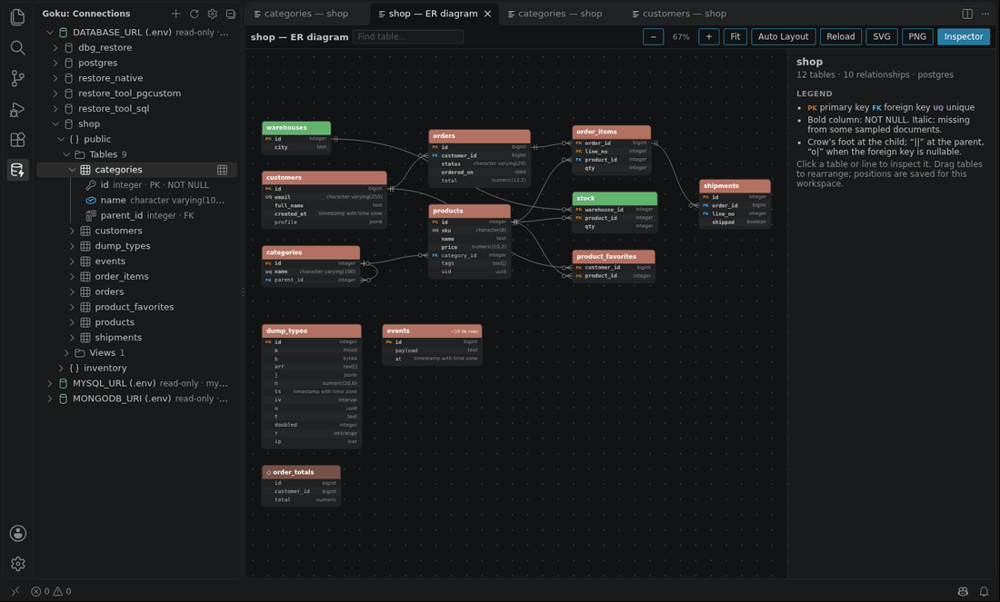
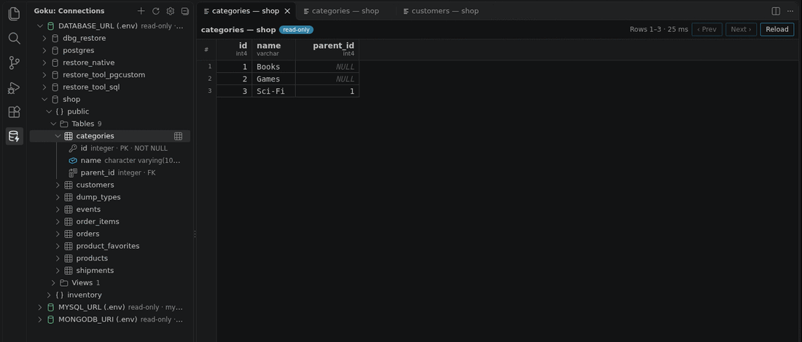

# Goku for VS Code (preview)

Browse PostgreSQL, MySQL/MariaDB and MongoDB databases from the VS Code sidebar: tables, views and collections with
their columns, a fast read-only data grid, and ER diagrams (including relationships inferred from MongoDB documents).
It runs on the same engine rules as the Goku app: every network wait has a deadline, results are capped, read-only
connections are enforced by the server too, and passwords stay in VS Code's secret storage.

## Features
- **Connections from where they already are**: `DATABASE_URL`, `POSTGRES_URL`, `MYSQL_URL`, `MONGODB_URI`, `PG*`,
  `MYSQL_*` and the Docker images' `POSTGRES_*` / `MYSQL_ROOT_PASSWORD` variables in your workspace `.env`, or
  connections you add to your settings (**Goku: Add Connection**, by fields or from a URL).
- **Sidebar tree**: connection → database → schema (PostgreSQL) → tables / views / materialized views / collections →
  columns (type, primary/foreign key, NOT NULL; field presence for MongoDB). Connections open when you expand them;
  a slow one can be cancelled (**Cancel Connecting**), a failure shows the server's message with Retry.
- **Table viewer**: double-click a table or collection (or press Enter). Virtualised grid for wide and long tables,
  paging, sorting by column, copying cells and rows as TSV; documents view for MongoDB.
- **ER diagrams**: on a database or schema, **Open ER Diagram**. Foreign keys for SQL databases, inferred references for
  MongoDB; drag tables (positions are saved per workspace), auto layout, search, an inspector, SVG/PNG export.

## Settings
| Setting | |
|---|---|
| `goku.connections` | Connections in the Goku app's profile format (`name`, `kind`, `hosts`, `user`, `database`, `ssl`, `readOnly`, …). No passwords here: Goku asks and keeps them in secret storage. |
| `goku.envFiles` | Files searched for connection variables, relative to each workspace folder (default `.env`). |
| `goku.envConnections` | More variables holding connection URLs, e.g. `{"url": "ANALYTICS_DB_URL", "name": "Analytics", "readOnly": false}`. |
| `goku.enginePath` | Use a locally built engine (machine setting, for development). |

## Security
- **Read-only by default** for connections found in `.env` files (a `DATABASE_URL` is often production). Read-only is
  enforced by the client and by the database session (PostgreSQL and MySQL); `goku.envConnections[].readOnly: false`
  turns it off for one variable.
- **Secrets**: passwords are never written to settings or logs. Typed passwords go to VS Code's secret storage (or are
  kept until VS Code closes, your choice) and are only handed out for the server they were typed for. Passwords in
  `.env` are read when connecting and never stored. The engine receives them over its private stdin pipe, never on the
  command line or in the environment; shown endpoints and error messages are redacted.
- **Workspace Trust**: in an untrusted workspace Goku ignores its `.env` files and workspace settings; only your own
  user settings apply.
- The engine is a separate process per window with a crash budget; it never takes VS Code down.

## Platforms
Windows, macOS and Linux, x64 and arm64 (one package per platform with its engine), including Remote-SSH, WSL and dev
containers, where the engine runs on the remote side.

## Not yet
SSH tunnels, a query editor, editing rows and exporting data are planned. Feedback and bug reports are welcome.
